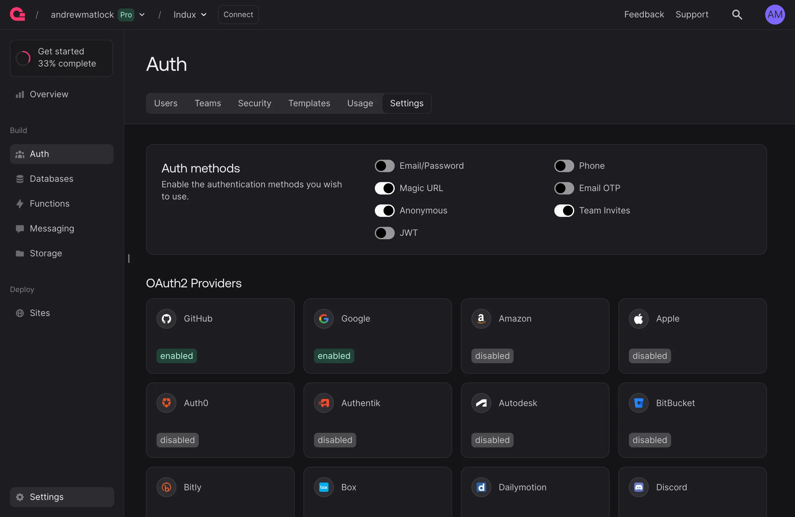

# Users

Enable guests and user accounts in your project.

---

## Appwrite Configuration

::: frame

:::

Your Appwrite project's Auth dashboard provides various options to customize the user experience. Go to <b>Auth</b> > <b>Settings</b> to enable your preferred sign-in methods. The auth module currently supports:
- OAuth2 Providers (Google, Apple, GitHub, Discord, and 35+ more)
- Anonymous (guest sessions)
- Magic URL
- Email OTP (one-time passcode)
- Phone OTP (SMS one-time passcode)
- Passkey (Face ID, Touch ID, fingerprint or device PIN)

See Appwrite's <a href="https://appwrite.io/docs/products/auth" target="_blank" rel="noopener">Auth docs</a> for all configuration details.

---

## Sign-in Methods

With Manifest and Appwrite, a frontend user registration flow (vs. a login flow) is not required. Unrecognized users will have a new account automatically generated, while known users will login to their existing account (from any sign-in method). [Passkeys](#passkeys) are the exception: a passkey is added to an account the user has already signed in to.

::: brand icon="lucide:info"
Interactive examples on this page demonstrate real authentication with **you** as the user. Each example reflects the most recent auth state you've set (e.g. signed-in or out). Example styles and layouts may differ from code snippets.
:::

In `manifest.json`, use the auth `methods` array to define your project's sign-in methods, and enable each one in the connected Appwrite project. Without `methods`, magic URLs and OAuth are enabled (`["magic", "oauth"]`). The `auth` object itself is what loads the auth module, so include it even when empty (`"auth": {}`).

```json "manifest.json" copy
{
    "appwrite": {
        "projectId": "your-project-id",
        "endpoint": "your-API-endpoint",
        "auth": {
            "methods": [ "oauth", "magic", "guest-manual" ]
        }
    }
}
```

| Method | Description |
|--------|-------------|
| `guest-auto`{copy} | Automatically creates anonymous guest sessions for all visitors (`guest`{copy} is an accepted synonym) |
| `guest-manual`{copy} | Allows users to manually create guest sessions via `$auth.requestGuest()`{copy} |
| `magic`{copy} | Enables passwordless login via magic URLs sent to email |
| `otp`{copy} | Enables passwordless login via a one-time passcode sent to email |
| `phone`{copy} | Enables passwordless login via a one-time passcode sent by SMS |
| `passkey`{copy} | Enables sign-in with a passkey saved on the user's device or password manager |
| `oauth`{copy} | Enables OAuth sign-in with providers like Google, GitHub, etc. |

---

### OAuth

OAuth enables sign-in with third-party providers like Google, GitHub, and 35+ other services supported by and configured in Appwrite's <b>Auth</b> > <b>Settings</b> page.

<div x-code-group>

```json "manifest.json" copy
{
    "appwrite": {
        ...
        "auth": {
            "methods": ["oauth"]
        }
    }
}
```

```html "HTML" copy
<button @click="$auth.loginOAuth('google')" :disabled="($auth.isAuthenticated && !$auth.isAnonymous) || $auth.inProgress">Sign in with Google</button>
<button @click="$auth.loginOAuth('github')" :disabled="($auth.isAuthenticated && !$auth.isAnonymous) || $auth.inProgress">Sign in with GitHub</button>
<button @click="$auth.logout()" :disabled="!$auth.isAuthenticated || $auth.inProgress">Logout</button>

<!-- Status -->
<p x-show="$auth.inProgress">Authorizing...</p>
<p x-show="$auth.isAuthenticated">You're signed-in using <b x-text="$auth.method || 'guest'"></b><span x-show="$auth.provider"> via <b x-text="$auth.provider"></b></span> as <b x-text="$auth.user?.email || 'a guest'"></b></p>
<p x-show="!$auth.isAuthenticated">You're not signed-in.</p>
<p x-show="$auth.error" x-text="$auth.error"></p>
```

::: frame col gap-4 text-base
<div class="row-wrap gap-2">
    <button @click="$auth.loginOAuth('google')" :disabled="($auth.isAuthenticated && !$auth.isAnonymous) || $auth.inProgress">Sign in with Google</button>
    <button @click="$auth.loginOAuth('github')" :disabled="($auth.isAuthenticated && !$auth.isAnonymous) || $auth.inProgress">Sign in with GitHub</button>
    <button @click="$auth.logout()" :disabled="!$auth.isAuthenticated || $auth.inProgress">Logout</button>
</div>

<!-- Status -->
<p x-show="$auth.inProgress">Authorizing...</p>
<p x-show="$auth.isAuthenticated">You're signed-in using <b x-text="$auth.method || 'guest'"></b><span x-show="$auth.provider"> via <b x-text="$auth.provider"></b></span> as <b x-text="$auth.user?.email || 'a guest'"></b></p>
<p x-show="!$auth.isAuthenticated">You're not signed-in.</p>
<p x-show="$auth.error" x-text="$auth.error"></p>
:::

</div>

The `$auth.loginOAuth('...')` method accepts provider names like `google`, `github`, and `discord`. When applicable, the user is redirected to the provider's sign-in page and gets returned when authenticated.

---

### Magic URLs

Magic URLs provide passwordless authentication via email. Users enter their email address and get emailed a sign-in link that's valid for one hour, which can be used once.

<div x-code-group>

```json "manifest.json" copy
{
    "appwrite": {
        ...
        "auth": {
            "methods": ["magic"]
        }
    }
}
```

```html "HTML" copy
<!-- Form -->
<input type="email" pattern=".*@.*\..*" required autocomplete="on" placeholder="Input email" aria-label="Email" class="peer" @keyup.enter="$auth.sendMagicLink()" :disabled="($auth.isAuthenticated && !$auth.isAnonymous) || $auth.inProgress" />
<button class="peer-invalid:disabled" @click="$auth.sendMagicLink()" :disabled="($auth.isAuthenticated && !$auth.isAnonymous) || $auth.inProgress">Send Magic URL</button>
<button @click="$auth.logout()" :disabled="!$auth.isAuthenticated || $auth.inProgress" class="!w-fit">Logout</button>

<!-- Status -->
<p x-show="$auth.inProgress">Authorizing...</p>
<p x-show="$auth.magicLinkSent">Magic URL sent. Check your inbox or spam to sign-in.</p>
<p x-show="$auth.magicLinkExpired">Magic URL expired. Please try again.</p>
<p x-show="$auth.isAuthenticated">You're signed-in using <b x-text="$auth.method || 'guest'"></b><span x-show="$auth.provider"> via <b x-text="$auth.provider"></b></span> as <b x-text="$auth.user?.email || 'a guest'"></b></p>
<p x-show="!$auth.isAuthenticated">You're not signed-in.</p>
<p x-show="$auth.error" x-text="$auth.error"></p>
```

::: frame col gap-4 text-base
<!-- Form -->
<div class="row-wrap gap-2">
    <input class="flex-1 max-w-full peer" type="email" pattern=".*@.*\..*" required autocomplete="on" placeholder="Input email" aria-label="Email" @keyup.enter="$auth.sendMagicLink()" :disabled="($auth.isAuthenticated && !$auth.isAnonymous) || $auth.inProgress" />
    <button class="peer-invalid:disabled" @click="$auth.sendMagicLink()" :disabled="($auth.isAuthenticated && !$auth.isAnonymous) || $auth.inProgress">Send Magic URL</button>
    <button @click="$auth.logout()" :disabled="!$auth.isAuthenticated || $auth.inProgress" class="!w-fit">Logout</button>
</div>

<!-- Status -->
<p x-show="$auth.inProgress">Authorizing...</p>
<p x-show="$auth.magicLinkSent">Magic URL sent. Check your inbox or spam to sign-in.</p>
<p x-show="$auth.magicLinkExpired">Magic URL expired. Please try again.</p>
<p x-show="$auth.isAuthenticated">You're signed-in using <b x-text="$auth.method || 'guest'"></b><span x-show="$auth.provider"> via <b x-text="$auth.provider"></b></span> as <b x-text="$auth.user?.email || 'a guest'"></b></p>
<p x-show="!$auth.isAuthenticated">You're not signed-in.</p>
<p x-show="$auth.error" x-text="$auth.error"></p>
:::

</div>

The button's `$auth.sendMagicLink()` method automatically finds the email input in the same parent element, form element, or otherwise finds the first email input on the page. To target a specific input, add its element ID like `$auth.sendMagicLink('#email-input')`. When activated, a magic URL is sent and the email input field is cleared.

When users click the magic URL in their email, they're redirected back to your app. The module automatically handles the callback and creates the session.

Email content can be customized in Appwrite under <b>Auth</b> > <b>Templates</b> > <b>Magic URL</b>.

---

### Email OTP

Email OTP provides passwordless authentication via a one-time passcode. Users enter their email address, receive a short code by email, then enter that code to sign in — all on the same page, with no redirect.

<div x-code-group>

```json "manifest.json" copy
{
    "appwrite": {
        ...
        "auth": {
            "methods": ["otp"]
        }
    }
}
```

```html "HTML" copy
<!-- Step 1: request a code -->
<input type="email" placeholder="Email" x-show="!$auth.otpSent" @keyup.enter="$auth.sendEmailOTP()" />
<button x-show="!$auth.otpSent" @click="$auth.sendEmailOTP()">Email code</button>

<!-- Step 2: enter the code -->
<input name="otp" placeholder="Code" x-show="$auth.otpSent" @keyup.enter="$auth.submitOTP()" />
<button x-show="$auth.otpSent" @click="$auth.submitOTP()">Verify</button>

<p x-show="$auth.otpSent">Code sent — check your inbox.</p>
```

::: frame col gap-4 text-base
<!-- Request a code -->
<div class="row-wrap gap-2" x-show="!$auth.otpSent">
    <input class="flex-1 max-w-full peer" type="email" pattern=".*@.*\..*" required autocomplete="on" placeholder="Input email" aria-label="Email" @keyup.enter="$auth.sendEmailOTP()" :disabled="($auth.isAuthenticated && !$auth.isAnonymous) || $auth.inProgress" />
    <button class="peer-invalid:disabled" @click="$auth.sendEmailOTP()" :disabled="($auth.isAuthenticated && !$auth.isAnonymous) || $auth.inProgress">Email Code</button>
</div>
<!-- Enter the code -->
<div class="row-wrap gap-2" x-show="$auth.otpSent">
    <input class="flex-1 max-w-full" name="otp" inputmode="numeric" autocomplete="one-time-code" placeholder="Enter code" aria-label="One-time code" @keyup.enter="$auth.submitOTP()" :disabled="$auth.inProgress" />
    <button @click="$auth.submitOTP()" :disabled="$auth.inProgress">Verify</button>
</div>
<button @click="$auth.logout()" :disabled="!$auth.isAuthenticated || $auth.inProgress" class="!w-fit">Logout</button>

<!-- Status -->
<p x-show="$auth.inProgress">Authorizing...</p>
<p x-show="$auth.otpSent">Code sent. Check your inbox or spam.</p>
<p x-show="$auth.otpExpired">Code was invalid or expired. Please try again.</p>
<p x-show="$auth.isAuthenticated">You're signed-in using <b x-text="$auth.method || 'guest'"></b> as <b x-text="$auth.user?.email || 'a guest'"></b></p>
<p x-show="!$auth.isAuthenticated">You're not signed-in.</p>
<p x-show="$auth.error" x-text="$auth.error"></p>
:::

</div>

`$auth.sendEmailOTP()` finds the email input the same way `sendMagicLink()` does (nearest input, form, or first on the page), or accepts a selector like `$auth.sendEmailOTP('#email-input')`.

After a code is sent, `$auth.otpSent` becomes `true`; `$auth.submitOTP()` reads the code input (any `input[name="otp"]`, `autocomplete="one-time-code"`, or numeric input) and completes sign-in. Pass `{ phrase: true }` to `sendEmailOTP` to enable Appwrite's anti-phishing security phrase, then display `$auth.otpPhrase` alongside the code field.

Email content and code length can be customized in Appwrite under <b>Auth</b> > <b>Templates</b> > <b>OTP</b>.

---

### Phone OTP

Phone OTP provides passwordless authentication via a one-time passcode sent by SMS. Users enter their phone number, receive a short code by text, then enter that code to sign in — all on the same page, with no redirect.

<div x-code-group>

```json "manifest.json" copy
{
    "appwrite": {
        ...
        "auth": {
            "methods": ["phone"]
        }
    }
}
```

```html "HTML" copy
<!-- Step 1: request a code -->
<input type="tel" placeholder="+14155550123" x-show="!$auth.otpSent" @keyup.enter="$auth.sendPhoneOTP()" />
<button x-show="!$auth.otpSent" @click="$auth.sendPhoneOTP()">Text code</button>

<!-- Step 2: enter the code -->
<input name="otp" placeholder="Code" x-show="$auth.otpSent" @keyup.enter="$auth.submitOTP()" />
<button x-show="$auth.otpSent" @click="$auth.submitOTP()">Verify</button>

<p x-show="$auth.otpSent">Code sent — check your phone.</p>
```

</div>

`$auth.sendPhoneOTP()` finds the phone input the same way `sendEmailOTP()` does (nearest `input[type="tel"]`, form, or first on the page), or accepts a selector like `$auth.sendPhoneOTP('#phone-input')`. Numbers must include the country code (international E.164 format, e.g. `+14155550123`); common separators like spaces, dashes, and parentheses are stripped automatically.

The code-entry step is shared with email OTP: the same `$auth.submitOTP()` and `$auth.otpSent`/`$auth.otpExpired` flags drive it, so the verify markup is identical.

Phone OTP requires an SMS provider (Twilio, Vonage, MSG91, or Telesign) connected in Appwrite under <b>Messaging</b> > <b>Providers</b>, and the Phone method enabled under <b>Auth</b> > <b>Settings</b>.

---

### Passkeys

A passkey lets a user sign in with Face ID, Touch ID, a fingerprint or their device PIN, with no email, code or redirect. The passkey lives on the user's device or in their password manager and only works on your domain. Passkeys need mnfst 0.5.345 or later, Appwrite Cloud or self-hosted Appwrite 2.5 or later, and a current Appwrite SDK script (`appwrite@latest`, or 28.2.0 and up if you pin a version).

A passkey belongs to an existing account, so there are two steps: the user signs in another way and adds a passkey, then uses it to sign in from then on. Pair `passkey` with at least one other method.

<div x-code-group>

```json "manifest.json" copy
{
    "appwrite": {
        ...
        "auth": {
            "methods": ["passkey", "magic"]
        }
    }
}
```

```html "HTML" copy
<!-- Sign in with a passkey -->
<button x-show="$auth.passkeySupported && (!$auth.isAuthenticated || $auth.isAnonymous)" @click="$auth.loginPasskey()" :disabled="$auth.inProgress">Sign in with a passkey</button>

<!-- Signed in: add and manage passkeys -->
<div x-show="$auth.isAuthenticated && !$auth.isAnonymous" x-effect="$auth.isAuthenticated && !$auth.isAnonymous && $auth.listPasskeys()">
    <button x-show="$auth.passkeySupported" @click="$auth.addPasskey('My laptop')" :disabled="$auth.inProgress">Add a passkey</button>
    <template x-for="passkey in $auth.passkeys" :key="passkey.$id">
        <div>
            <span x-text="passkey.name || 'Passkey'"></span>
            <button @click="$auth.removePasskey(passkey.$id)">Remove</button>
        </div>
    </template>
</div>

<p x-show="$auth.error" x-text="$auth.error"></p>
```

</div>

In Appwrite, turn on <b>Passkey</b> under <b>Auth</b> > <b>Settings</b> and choose the domain your passkeys belong to. Use the main domain (`example.com`) rather than a subdomain, and make sure each hostname your site runs on is a web platform in the project. Appwrite will not let you change this domain once any passkey has been registered, including passkeys created while testing on `localhost`, so set the production domain first. Passkeys work on HTTPS on the default port, and on `http://localhost` for development (add `localhost` as a web platform; `127.0.0.1` does not work). See Appwrite's <a href="https://appwrite.io/docs/products/auth/passkeys" target="_blank" rel="noopener">passkey docs</a> for the full setup.

`$auth.passkeySupported` is `true` when the browser supports passkeys, so use it to show or hide the buttons. `$auth.loginPasskey()` shows the browser's passkey prompt and signs the user in; `$auth.method` then reads `'passkey'`. A passkey sign-in also satisfies Appwrite's multi-factor authentication.

`$auth.addPasskey(name)` registers a passkey for the signed-in user. The optional name is shown in the list. `$auth.listPasskeys()` loads the user's passkeys into `$auth.passkeys`, where each has `$id`, `name`, `$createdAt` and `accessedAt` (the last sign-in with it, empty until first used). `$auth.renamePasskey(id, name)` and `$auth.removePasskey(id)` change the list in place. Each user can have up to 10 passkeys. Removing a passkey stops it signing in, though it may stay saved on the user's device.

Appwrite only allows adding or removing a passkey within 10 minutes of the user signing in. After that, these calls fail with the code `reauth-required`: ask the user to sign in again, then retry.

Each passkey method resolves to `{ success: true }` plus its result (`user`, `passkey` or `passkeys`). On failure it resolves to `{ success: false, error, code }`, where `code` says why:

| Code | Meaning |
|------|---------|
| `cancelled`{copy} | The user dismissed the passkey prompt, or it timed out. `$auth.error` stays `null`. Browsers report some setup faults the same way, such as a domain that doesn't match. |
| `unsupported`{copy} | The browser has no passkey support, or the Appwrite SDK script is too old |
| `not-enabled`{copy} | `passkey` is missing from `methods`, Passkey is off in the Appwrite project, or the site's domain doesn't match one of the project's web platforms |
| `not-signed-in`{copy} | Adding or managing passkeys needs a signed-in user |
| `signed-in`{copy} | `loginPasskey()` was called while already signed in |
| `guest`{copy} | A guest tried to add or manage passkeys |
| `reauth-required`{copy} | The user signed in more than 10 minutes ago |
| `limit`{copy} | The account already has 10 passkeys |
| `exists`{copy} | This device or password manager already holds a passkey for the account |
| `invalid`{copy} | Appwrite rejected the passkey (for example it was removed), or the request expired |
| `rate-limited`{copy} | Too many attempts. Appwrite allows about 10 passkey sign-ins per IP address and 10 registration requests per user each hour. |
| `failed`{copy} | Anything else; see `error` |

```html copy
<button @click="const result = await $auth.addPasskey(); if (result.code === 'reauth-required') $toast('Sign in again to add a passkey')">Add a passkey</button>
```

With [guest sessions](#guest-sessions), a guest who signs in with a passkey keeps their guest session until the passkey is verified, then moves to their own account. The guest's teams are left behind unless [guest team carryover](#guest-team-carryover-otp) is set up. Carryover adds the guest's teams to the account as they are, so default teams the guest was given arrive as duplicates of the account's own. If the last step of the sign-in fails after the guest session has ended, the visitor is left signed out and `manifest:auth:session-cleared` fires.

`$auth.addPasskey()` is not offered to guests. This is a frontend check, like all `$auth` checks: while Passkey is on in the project, Appwrite itself accepts a passkey registration from any recently started session, guests included.

---

### Guest Sessions

Guest sessions allow visitors to browse your app without creating an account, with each session registered in the Appwrite userbase (including repeat visits from the same user). With Manifest, guest sessions can begin automatically or by a user action.

By default, when a guest signs in, a fresh account is created and the guest session is discarded, along with anything tied to it (such as guest-created [teams](/docs/framework/appwrite-modules/teams)). To keep them:

| Sign-in method | Keep the guest's data with |
|---|---|
| OAuth, magic URL | [`guestUpgrade`](#guest-upgrade): converts the guest's account in place |
| Email OTP, phone OTP, passkey | [`guestMigration`](#guest-team-carryover-otp): moves the guest's teams to the new account |

OTP sign-ins can't convert a guest in place (an Appwrite limitation), so they always create a fresh account. A passkey sign-in always moves the guest to the account the passkey belongs to.

<br>

#### Auto Guest Sessions

When `guest-auto` is enabled in your manifest, all visitors automatically enter a guest session on page load.

```json "manifest.json"
{
    "appwrite": {
        ...
        "auth": {
            "methods": ["guest-auto"]
        }
    }
}
```

<br>

#### Manual Guest Sessions

When `guest-manual` is enabled, visitors must explicitly choose to continue as a guest.

<div x-code-group>

```json "manifest.json" copy
{
    "appwrite": {
        ...
        "auth": {
            "methods": ["guest-manual"]
        }
    }
}
```

```html "HTML" numbers copy
<button @click="$auth.requestGuest()" :disabled="$auth.isAuthenticated || $auth.inProgress">Continue as Guest</button>
<button @click="$auth.logout()" :disabled="!$auth.isAuthenticated || $auth.inProgress">Logout</button>

<!-- Status -->
<p x-show="$auth.isAnonymous">You're a guest</p>
<p x-show="!$auth.isAnonymous && $auth.isAuthenticated">You're already signed in</p>
<p x-show="!$auth.isAuthenticated">You're not signed in</p>
```

::: frame col text-base
<div class="row-wrap gap-2">
    <button @click="$auth.requestGuest()" :disabled="$auth.isAuthenticated || $auth.inProgress">Continue as Guest</button>
    <button @click="$auth.logout()" :disabled="!$auth.isAuthenticated || $auth.inProgress" class="!w-fit">Logout</button>
</div>
<p x-show="$auth.isAnonymous">You're a guest</p>
<p x-show="!$auth.isAnonymous && $auth.isAuthenticated">You're already signed in</p>
<p x-show="!$auth.isAuthenticated">You're not signed in</p>
:::

</div>

<br>

#### Guest Upgrade

Set `guestUpgrade` to `true` to convert a guest's existing account in place when they sign in with OAuth or a magic URL, preserving its data and team memberships.

```json "manifest.json" copy
{
    "appwrite": {
        ...
        "auth": {
            "methods": ["guest-manual", "magic", "oauth"],
            "guestUpgrade": true
        }
    }
}
```

No markup changes are needed — `$auth.sendMagicLink()` and `$auth.loginOAuth()` handle the upgrade automatically when a guest signs in. `guestUpgrade` defaults to the value of `teams.guests`, so enabling guest teams turns it on for you.

<br>

#### Guest Team Carryover (OTP)

For email OTP, phone OTP and passkey sign-ins, `guestMigration` carries the guest's teams over to the new account by reassigning team membership.

Reassigning team ownership between accounts is privileged — it needs a server API key, so it has to run on a server, not in the browser. To make that turnkey, Manifest provides a ready-to-deploy <a href="https://github.com/Manifest-X/Manifest/tree/master/templates/guest-migration-function" target="_blank" rel="noopener">guest-migration function template</a>. Deploy it to your Appwrite project and point the module at it:

```json "manifest.json" copy
{
    "appwrite": {
        ...
        "auth": {
            "methods": ["guest-manual", "otp"],
            "teams": { "permanent": ["Workspace"], "guests": true },
            "guestMigration": { "functionId": "<your function id>" }
        }
    }
}
```

No markup changes — after a guest verifies an OTP code, the module transparently moves their teams to the new account. The same function also garbage-collects abandoned guests and their orphaned teams on a schedule.

The template is one ready-made implementation; the module just calls a function that speaks a small `prepare`/`commit` contract, so you can swap the function's internals for your own backend logic if you ever need to. Its <a href="https://github.com/Manifest-X/Manifest/tree/master/templates/guest-migration-function#readme" target="_blank" rel="noopener">README</a> walks through deploying it.

---

## Combined Methods

Sign-in methods can be stacked to provide optionality to users.

<div x-code-group>

```json "manifest.json" copy
{
    "appwrite": {
        ...
        "auth": {
            "methods":  ["guest-manual", "magic", "oauth"]
        }
    }
}
```

```html "HTML" numbers copy
<!-- OAuth Buttons -->
<button @click="$auth.loginOAuth('google')" :disabled="($auth.isAuthenticated && !$auth.isAnonymous) || $auth.inProgress"><i x-icon="simple-icons:google"></i> <span>Sign in with Google</span></button>
<button @click="$auth.loginOAuth('github')" :disabled="($auth.isAuthenticated && !$auth.isAnonymous) || $auth.inProgress"><i x-icon="simple-icons:github"></i> <span>Sign in with GitHub</span></button>

<div class="divider my-8">OR</div>

<!-- Magic URL Form -->
<input class="peer" type="email" pattern=".*@.*\..*" required autocomplete="on" placeholder="Input email" aria-label="Email" @keyup.enter="$auth.sendMagicLink()" :disabled="($auth.isAuthenticated && !$auth.isAnonymous) || $auth.inProgress" />
<button class="peer-invalid:disabled" @click="$auth.sendMagicLink()" :disabled="($auth.isAuthenticated && !$auth.isAnonymous) || $auth.inProgress">Send Magic URL</button>

<div class="divider my-8">OR</div>

<!-- Guest Button -->
<button @click="$auth.requestGuest()" :disabled="$auth.isAuthenticated || $auth.inProgress">Continue as Guest</button>

<!-- Status -->
<div class="my-8">
<p x-show="$auth.inProgress">Authorizing...</p>
<p x-show="$auth.magicLinkSent">Magic URL sent. Check your inbox or spam to sign-in.</p>
<p x-show="$auth.magicLinkExpired">Magic URL expired. Please try again.</p>
<p x-show="$auth.isAuthenticated">You're signed-in using <b x-text="$auth.method || 'guest'"></b><span x-show="$auth.provider"> via <b x-text="$auth.provider"></b></span> as <b x-text="$auth.user?.email || 'a guest'"></b></p>
<p x-show="!$auth.isAuthenticated">You're not signed-in.</p>
<p x-show="$auth.error" x-text="$auth.error"></p>
</div>

<!-- Logout -->
<button @click="$auth.logout()" :disabled="!$auth.isAuthenticated || $auth.inProgress">Logout</button>
```

::: frame text-base
<div class="col center gap-2 w-sm max-w-full mx-auto py-10 text-center [&_button]:w-full">
    <!-- OAuth Buttons -->
    <button  @click="$auth.loginOAuth('google')" :disabled="($auth.isAuthenticated && !$auth.isAnonymous) || $auth.inProgress"><i x-icon="simple-icons:google"></i> <span>Sign in with Google</span></button>
    <button @click="$auth.loginOAuth('github')" :disabled="($auth.isAuthenticated && !$auth.isAnonymous) || $auth.inProgress"><i x-icon="simple-icons:github"></i> <span>Sign in with GitHub</span></button>
    <div class="divider my-8">OR</div>
    <!-- Magic URL Form -->
    <input type="email" pattern=".*@.*\..*" required autocomplete="on" placeholder="Input email" aria-label="Email" class="peer" @keyup.enter="$auth.sendMagicLink()" :disabled="($auth.isAuthenticated && !$auth.isAnonymous) || $auth.inProgress"/>
        <button class="peer-invalid:disabled" @click="$auth.sendMagicLink()" :disabled="($auth.isAuthenticated && !$auth.isAnonymous) || $auth.inProgress">Send Magic URL</button>
    <div class="divider my-8">OR</div>
    <!-- Guest Button -->
    <button @click="$auth.requestGuest()" :disabled="$auth.isAuthenticated || $auth.inProgress">Continue as Guest</button>
    <!-- Status -->
    <div class="my-8">
        <p x-show="$auth.inProgress">Authorizing...</p>
        <p x-show="$auth.magicLinkSent">Magic URL sent. Check your inbox or spam to sign-in.</p>
        <p x-show="$auth.magicLinkExpired">Magic URL expired. Please try again.</p>
        <p x-show="$auth.isAuthenticated">You're signed-in using <b x-text="$auth.method || 'guest'"></b><span x-show="$auth.provider"> via <b x-text="$auth.provider"></b></span> as <b x-text="$auth.user?.email || 'a guest'"></b></p>
        <p x-show="!$auth.isAuthenticated">You're not signed-in.</p>
        <p x-show="$auth.error" x-text="$auth.error"></p>
    </div>
    <button @click="$auth.logout()" :disabled="!$auth.isAuthenticated || $auth.inProgress" class="!w-fit">Logout</button>
</div>
:::

</div>

---

## Properties

The auth module provides an `$auth` magic property that exposes authentication state and methods.

### Authentication State

#### User Profile ($auth.user)

Current user profile (null if not authenticated). The user object comes directly from Appwrite's `account.get()`.

| Property | Type | Description |
|----------|------|-------------|
| `$auth.user?.$id`{copy} | string | User's unique ID |
| `$auth.user?.email`{copy} | string | User's email address |
| `$auth.user?.name`{copy} | string | User's display name |
| `$auth.user?.$createdAt`{copy} | string | Account creation timestamp |
| `$auth.user?.$updatedAt`{copy} | string | Last update timestamp |
| `$auth.user?.prefs`{copy} | object | User preferences object |
| Other properties | - | All other Appwrite User object properties are available |

#### Session Information ($auth.session)

Current session details (null if not authenticated). The session object comes directly from Appwrite's session data.

| Property | Type | Description |
|----------|------|-------------|
| `$auth.session?.$id`{copy} | string | Session ID |
| `$auth.session?.userId`{copy} | string | User ID associated with session |
| `$auth.session?.expire`{copy} | string | Session expiration timestamp |
| `$auth.session?.provider`{copy} | string | Authentication provider used (`'anonymous'`, `'magic-url'`, `'email'` or `'token'` for email OTP, `'phone'`, or the OAuth provider name) |
| `$auth.session?.ip`{copy} | string | IP address of session |
| `$auth.session?.osCode`{copy} | string | Operating system code |
| `$auth.session?.osName`{copy} | string | Operating system name |
| `$auth.session?.osVersion`{copy} | string | Operating system version |
| `$auth.session?.deviceName`{copy} | string | Device name |
| `$auth.session?.deviceBrand`{copy} | string | Device brand |
| `$auth.session?.deviceModel`{copy} | string | Device model |
| Other properties | - | All other Appwrite Session object properties are available |

#### Status Flags

| Property | Type | Description |
|----------|------|-------------|
| `$auth.isAuthenticated`{copy} | boolean | Indicates if user is authenticated |
| `$auth.isAnonymous`{copy} | boolean | Indicates if user is a guest |
| `$auth.inProgress`{copy} | boolean | Indicates if an auth operation is in progress |
| `$auth.error`{copy} | string \| null | Error message string (null if no error) |
| `$auth.magicLinkSent`{copy} | boolean | Indicates if magic link was sent |
| `$auth.magicLinkExpired`{copy} | boolean | Indicates if magic link expired |
| `$auth.otpSent`{copy} | boolean | Indicates if an OTP code (email or SMS) was sent and awaits entry |
| `$auth.otpExpired`{copy} | boolean | Indicates if the entered OTP code was invalid or expired |
| `$auth.otpPhrase`{copy} | string \| null | Email OTP anti-phishing security phrase (when requested with `{ phrase: true }`) |
| `$auth.guestManualEnabled`{copy} | boolean | Indicates if manual guest creation is enabled |
| `$auth.passkeySupported`{copy} | boolean | Indicates if the browser supports passkeys |
| `$auth.passkeys`{copy} | array | The signed-in user's passkeys, loaded by `$auth.listPasskeys()` |

---

### Computed Properties

| Property | Type | Description |
|----------|------|-------------|
| `$auth.method`{copy} | string \| null | Authentication method: `'oauth'`, `'magic'`, `'otp'`, `'phone'`, `'passkey'`, `'anonymous'`, or `null` |
| `$auth.provider`{copy} | string \| null | OAuth provider name (e.g., `'google'`, `'github'`) or `null` for non-OAuth methods |

---

### Available Methods

| Method | Parameters | Description |
|--------|------------|-------------|
| `$auth.loginOAuth(...)`{copy} | `provider` (string), `successUrl` (optional), `failureUrl` (optional) | Sign in with OAuth provider. Redirects to provider. |
| `$auth.sendMagicLink(...)`{copy} | `emailInputOrRef` (element ID or element, optional), `redirectUrl` (optional) | Send magic link to email. |
| `$auth.sendEmailOTP(...)`{copy} | `emailInputOrRef` (selector or element, optional), `options` (optional, `{ phrase: true }` for a security phrase) | Email a one-time passcode. |
| `$auth.sendPhoneOTP(...)`{copy} | `phoneInputOrRef` (selector or element, optional) | Text a one-time passcode to a phone number (E.164 format). |
| `$auth.submitOTP(...)`{copy} | `codeInputOrRef` (selector or element, optional) | Verify the entered passcode and complete sign-in (email or phone). |
| `$auth.loginPasskey()`{copy} | None | Sign in with a passkey. |
| `$auth.addPasskey(...)`{copy} | `name` (string, optional) | Register a passkey for the signed-in user. |
| `$auth.listPasskeys()`{copy} | None | Load the signed-in user's passkeys into `$auth.passkeys`. |
| `$auth.renamePasskey(...)`{copy} | `passkey` (ID or passkey object), `name` (string) | Rename a passkey. |
| `$auth.removePasskey(...)`{copy} | `passkey` (ID or passkey object) | Remove a passkey from the account. |
| `$auth.requestGuest()`{copy} | None | Create a manual guest session. |
| `$auth.logout()`{copy} | None | Delete current session and sign out. If automatic guest sessions are enabled, a new guest session will begin after logout. |
| `$auth.refresh()`{copy} | None | Refresh user data from Appwrite. |
| `$auth.canAuthenticate()`{copy} | None | Check if user can authenticate (not already signed in or in progress). |

---

## Session Recovery

Signing in or out in one tab updates every open tab, and every Appwrite table and bucket source reloads for the new user, so the previous user's entries never linger. With auto guest sessions, signing out moves every tab to a new guest session.

If the app opens offline, it renders signed out (`$auth.isAuthenticated` is `false`) and restores the session on its own once Appwrite is reachable (it rechecks on reconnect, on tab refocus, and after 2, 5, 15 and 60 seconds); no guest session is created over the real one. Only a genuine "no session" answer from Appwrite signs a user out. Listen for `manifest:auth:login` to react when the session returns.

While offline, [persisted](/docs/framework/core-modules/local-data#persisted-data) rows saved for the user last signed in on this device stay shown for every source, including tables with a [scope](/docs/framework/appwrite-modules/databases#scope) and sources whose queries reference `$auth.` values, unless the persistence `scope` depends on the signed-in user or team, which can't be evaluated until the session is verified (the saved rows stay on the device until then). A restored session reloads them; a "no session" answer, a sign-out, or a different user clears them.

---

## Events

The auth module dispatches these events on `window`:

| Event | Fires when |
|-------|------------|
| `manifest:auth:initialized`{copy} | The session check on page load has finished, signed in or not (`detail.isAuthenticated`, `detail.isAnonymous`) |
| `manifest:auth:login`{copy} | A user signs in, or a session is restored (`detail.user` holds the user) |
| `manifest:auth:anonymous`{copy} | A guest session starts |
| `manifest:auth:logout`{copy} | The user signs out, or the session has expired |
| `manifest:auth:session-cleared`{copy} | The session ended or changed elsewhere, such as in another tab |
| `manifest:auth:teams-loaded`{copy} | The user's [teams](/docs/framework/appwrite-modules/teams) have loaded |
| `manifest:auth:passkey-added`{copy} | A passkey was registered (`detail.passkey`) |
| `manifest:auth:passkey-removed`{copy} | A passkey was removed (`detail.passkeyId`) |
| `manifest:auth:before-logout`{copy} | A session is about to end through `$auth`: signing out, or a guest session replaced by a sign-in (`detail.waitUntil(promise)` holds the sign-out briefly) |

```html copy
<div x-data @manifest:auth:login.window="$toast('Welcome back')"></div>
```

On page load, a returning signed-in visitor's account, session and (with [teams](/docs/framework/appwrite-modules/teams) enabled) team list are requested together, then the current team's members and roles together. When a [starting team](/docs/framework/appwrite-modules/teams#starting-team) is known, its members and roles go out with the first group. `manifest:auth:initialized` fires as soon as the session is known, before teams load, and when teams load, `manifest:auth:teams-loaded` follows. Sign-in link returns (magic URL, team invite, OAuth) and [auto guest sessions](#auto-guest-sessions) are handled right after `manifest:auth:initialized`. Since 0.5.337 they run even when the session check finishes very quickly, which earlier versions could skip.

### Cleanup Before Sign-out

Since 0.5.307, `manifest:auth:before-logout` fires while the session is still valid, so your code can finish work that needs it, such as deleting a record only the user may delete. Pass a promise to `event.detail.waitUntil()` and the session ends once it settles, or after 3 seconds at most so sign-out never hangs. [Presence](/docs/framework/appwrite-modules/presence) uses it to remove the person's status.

```js copy
window.addEventListener('manifest:auth:before-logout', (event) => {
    event.detail.waitUntil(saveDraft());
});
```

The event only fires for sessions ended through `$auth`. A session that expires or is revoked elsewhere ends without it.

---

## Next Steps

See [teams](/docs/framework/appwrite-modules/teams) to enable shared workspaces between users, including roles and permissions.