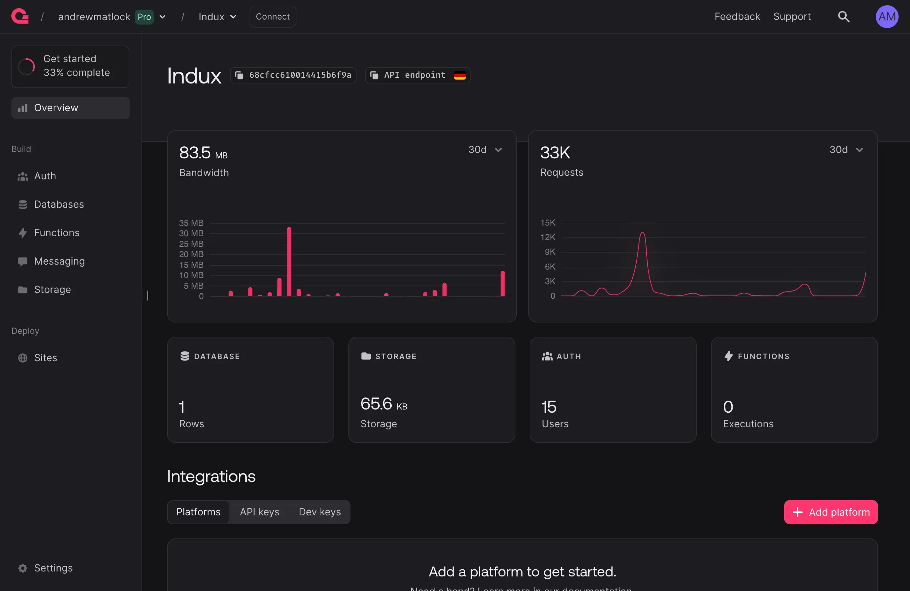
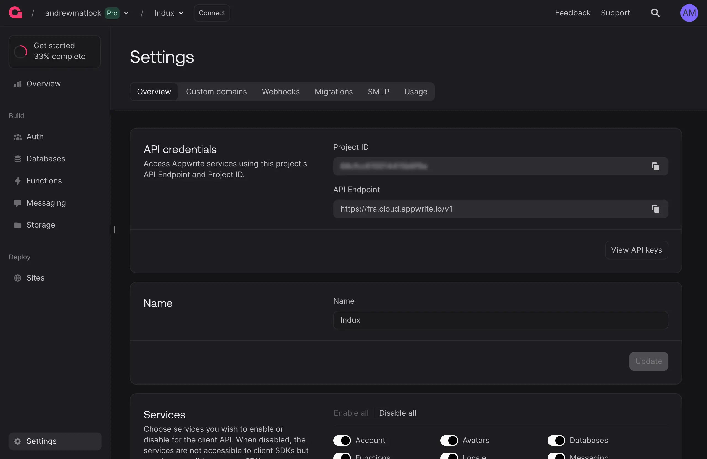
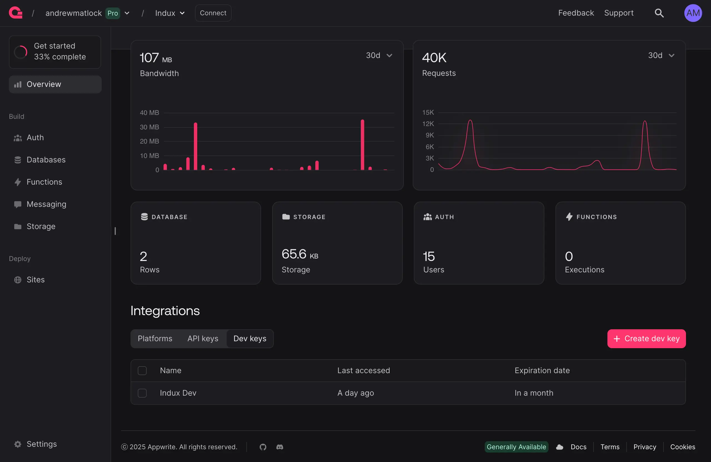

# Appwrite Setup

Use <a href="https://appwrite.io/" target="_blank" rel="noopener">Appwrite</a> to turn Manifest projects into production-ready applications.

---

## Overview

Appwrite provides turnkey backend infrastructure, available <a href="https://github.com/appwrite/appwrite" target="_blank">open source</a> or <a href="https://appwrite.io/" target="_blank">cloud hosted</a> with a generous free tier. Together with Manifest you can quickly generate feature-complete applications including user authentication, databases, and storage.

---

## In Appwrite

Establish a project with any name and region in <a href="https://appwrite.io/" target="_blank" rel="noopener">Appwrite</a>. Once created you'll access the project console:

::: frame

:::

---

### Credentials

Your Manifest project will need the Appwrite project's <b>Project ID</b> and <b>API Endpoint</b> to connect. Get them from the Appwrite project's general <b>Settings</b>, under API credentials:

::: frame

:::

---

### Web Platform

Appwrite only accepts browser requests from hostnames registered with the project. From the project <b>Overview</b>, select <b>Add platform</b> > <b>Web</b> and enter each hostname that will run your Manifest project:

- `localhost` for local development
- Each staging and production domain, such as `example.com`

Without this, sign-in and data requests are blocked by the browser.

---

### Dev Key

An optional <b>Dev Key</b> can also be used during Manifest project development to bypass Appwrite's rate limits. It should not be included in production. Get one from <b>Overview</b> > <b>Dev keys</b>:

::: frame

:::

---

## Manifest Setup

### Scripts

Add the Appwrite SDK and `manifest.js` scripts to the HTML head. `manifest.json` is also required to register Appwrite credentials and data sources.

Appwrite plugins can be loaded in two ways: explicitly via the `data-plugins` attribute, or automatically from `manifest.json`. When auto-detected, the data plugin loads when an `appwrite` object is present, the auth plugin when that object includes `auth` (even `"auth": {}`), and [presence](/docs/framework/appwrite-plugins/presence) when it includes `presence`. The supporting core data plugin will also be loaded whether or not it's declared.

<div x-code-group>

```html "Auto-detect" copy
<!-- Meta -->
<link rel="manifest" href="/manifest.json">

<!-- Scripts -->
<script src="https://cdn.jsdelivr.net/npm/appwrite@latest"></script>
<script src="https://cdn.jsdelivr.net/npm/mnfst@latest/lib/manifest.min.js"></script>
```

```html "Declared" copy
<!-- Meta -->
<link rel="manifest" href="/manifest.json">

<!-- Scripts -->
<script src="https://cdn.jsdelivr.net/npm/appwrite@latest"></script>
<script src="https://cdn.jsdelivr.net/npm/mnfst@latest/lib/manifest.min.js"
    data-plugins="+appwrite-auth,+appwrite-data"></script>
```

</div>

---

### manifest.json

Add the Appwrite project credentials detailed [above](#credentials) to `manifest.json` under an `appwrite` property. These are inherited by any other objects in the manifest that reference Appwrite, like database or storage sources.

The Project ID and API Endpoint are public and safe to commit — Appwrite enforces access via its own project-level permissions. The Dev Key is sensitive (it bypasses rate limits) and must not be committed. Reference it via `${PUBLIC_APPWRITE_DEV_KEY}` and put the value in a gitignored `.env` file. Only variables prefixed `PUBLIC_` reach the browser, so the name needs that prefix. The same `${VAR}` syntax is also supported for the Project ID and API Endpoint if you prefer to keep them out of source.

<div x-code-group>

```json "manifest.json" copy
{
    "appwrite": {
        "projectId": "your-project-id",
        "endpoint": "your-API-endpoint",
        "devKey": "${PUBLIC_APPWRITE_DEV_KEY}"
    }
}
```

```env ".env" copy
PUBLIC_APPWRITE_DEV_KEY=your-appwrite-dev-key
```

</div>

::: brand icon="lucide:info"
**How `${VAR}` resolution works.** The framework substitutes `${VAR}` placeholders in `manifest.json` against `window.env` at runtime. The `npx mnfst-run`{copy} dev server reads your project's `.env` at startup and injects its `PUBLIC_` variables as a `window.env = {…}` block into served HTML. Other variables stay on the server, so a placeholder without the prefix is left unresolved, and an unresolved Dev Key turns the auth plugin off. If you serve the project with your own local server (Python's `http.server`, `live-server`, `serve`, etc.), it won't inject `window.env` for you; you'll need to add a `<script>window.env = {…}</script>` block to `index.html` before the `manifest.min.js` tag, or your placeholders will reach the plugin unresolved and the auth/data plugins will refuse to initialize.
:::

::: brand icon="lucide:info"
**Production deployments.** Static hosts (Netlify, Vercel, Cloudflare Pages, GitHub Pages, S3, etc.) serve `manifest.json` verbatim — no runtime substitution. The Dev Key should not ship to production in the first place: it's strictly a development-time convenience for bypassing Appwrite's rate limits, and Appwrite enforces real auth through project-level permissions for live users. For any other `${VAR}` values you actually need in production, either hardcode them directly in `manifest.json` (acceptable for public values like Project ID and API Endpoint), bake them into the prerendered HTML at build time, or use your host's env-var injection feature.
:::

Data sources always connect with these `appwrite` credentials. A [database](/docs/framework/appwrite-plugins/databases) source can name its own database with `appwriteDatabaseId`; without it, the source uses `appwrite.databaseId`, then `main`.

---

## Next Steps

After a successful setup above, your Manifest project should be paired with your Appwrite project(s). Proceed to configuring:

- [Users](/docs/framework/appwrite-plugins/users) or [Teams](/docs/framework/appwrite-plugins/teams)
- [Databases](/docs/framework/appwrite-plugins/databases) or [Storage](/docs/framework/appwrite-plugins/storage)