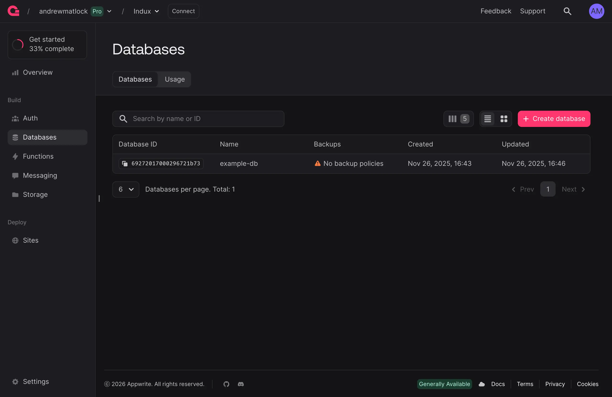
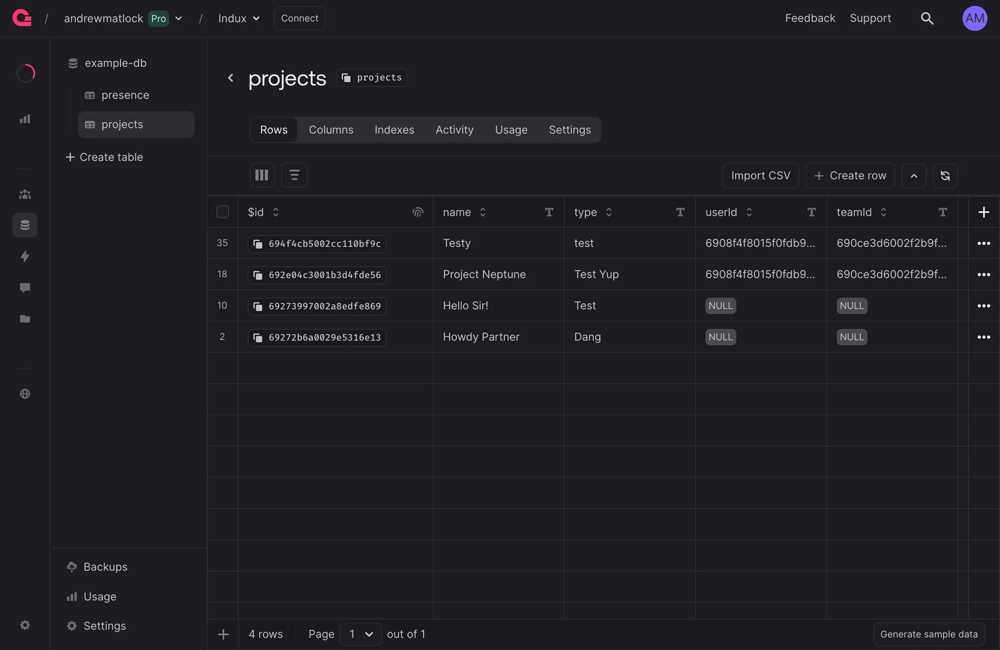

# Databases

Query and manage Appwrite database tables.

---

## Appwrite Configuration

In your Appwrite project's **Databases** dashboard, create a database.

::: frame

:::

The database must have at least one table.

::: frame

:::

Add columns to the table matching your data structure. Appwrite automatically applies `$id`, `$createdAt`, and `$updatedAt` columns to every table. In the example above, we've established a table that will store fictitious "projects".

::: brand icon="lucide:info"
In a table's **Settings** tab, ensure any permissions required by your frontend user experience (**Create**, **Read**, **Update**, **Delete**) are checked.
:::

---

## Register Database Tables

Register database tables in your `manifest.json` under the `data` property, same as [local data files](/docs/framework/core-plugins/local-data). Include the `appwriteDatabaseId` and `appwriteTableId` values provided by Appwrite.


```json "manifest.json" copy
{
    "data": {
        "projects": {
            "appwriteDatabaseId": "your-database-id",
            "appwriteTableId": "your-table-id"
        }
    },
    "appwrite": {
        "projectId": "your-project-id",
        "endpoint": "your-API-endpoint"
    }
}
```

In this example, the "projects" data source name is arbitrary, used to later reference table content in the frontend. An Appwrite data source will automatically reference the `appwrite` property for credentials.

`appwriteDatabaseId` falls back to `appwrite.databaseId`, then to `main`, so later examples omit it.

::: brand icon="lucide:info"
Appwrite returns 25 rows when a request sets no limit, so a table source without a `limit` query shows at most 25 rows. Add a `["limit", N]` query to its `queries` to load more, or set [`paging`](#large-tables) to load every row or a window you extend as people scroll.
:::

### Scope

Scoping automatically filters queries by user or team, ensuring users only see data they're permitted to access. Configure scope in `manifest.json`:

```json "manifest.json" copy
{
    "data": {
        "projects": {
            "appwriteTableId": "your-table-id",
            "scope": "user"
        }
    }
}
```

Scope options are:

| Scope | Description | Column Used |
|-------|-------------|-------------|
| `"user"` | Single user's data | `userId` |
| `"team"` | Current team's data | `teamId` |
| `"teams"` | All teams user belongs to | `teamId` |
| `["user", "team"]` | User's data OR current team's data | `userId` OR `teamId` |
| `["user", "teams"]` | User's data OR any team's data | `userId` OR `teamId` |

Scope queries are always prepended to user queries, ensuring scope restrictions cannot be bypassed.

By default scope filters on the `userId`/`teamId` columns. If your table names them differently (e.g. a `workspaceId` column), set `scopeColumn`:

```json "manifest.json" copy
{
    "data": {
        "projects": {
            "appwriteTableId": "your-table-id",
            "scope": "team",
            "scopeColumn": "workspaceId"
        }
    }
}
```

`scopeColumn` can also be an object to name the user and team columns independently: `{ "team": "workspaceId", "user": "ownerId" }`.

When using `["user", "team"]` scope, projects are shown for the current user OR the current team. If no team is selected (`$auth.currentTeam`), only user-scoped projects will display. Use `"teams"` (plural) instead of `"team"` (singular) to query all teams the user belongs to, not just the current team.

**Signed out.** While no user is signed in, a scoped table (or one whose queries reference `$auth.` values) settles as empty: the source is `[]`, `$ready` is `true`, and no request is sent. It loads when the user signs in. Like every table source, it reloads whenever the identity changes, so one user's entries never carry over to the next (see [cloud data](/docs/framework/appwrite-plugins/cloud-data) and [session recovery](/docs/framework/appwrite-plugins/users#session-recovery)).

::: brand icon="lucide:info"
All interactive examples below require you to be logged into a dummy account via the [users](/docs/framework/appwrite-plugins/users) article. The data entries you generate below use the `team` scope.
:::

---

## Display & Manage Entries

Database tables work identically to local data sources. Access entries using the `$x` magic method and perform all CRUD operations:

<div x-code-group numbers copy>

```html "All"
<div x-data="{ newName: '' }">
    <!-- Create -->
    <input type="text" placeholder="Project name" aria-label="Project name" x-model="newName" />
    <button @click="$x.projects.$create({ name: newName, type: 'demo' }).then(() => { newName = ''; })" :disabled="!newName || $x.projects.$error">
        Create
    </button>
    
    <!-- List with inline edit, duplicate, and delete -->
    <template x-for="project in $x.projects" :key="project.$id">
        <div>
            <input 
                type="text" 
                :value="project.name" 
                @blur="$x.projects.$update(project.$id, { name: $event.target.value })"
            />
            <button @click="$x.projects.$duplicate(project.$id, { files: 'same' })" x-icon="lucide:copy" aria-label="Duplicate"></button>
            <button @click="$x.projects.$delete(project.$id)" x-icon="lucide:trash" aria-label="Delete"></button>
        </div>
    </template>
</div>
```

```html "Display" copy
<!-- Display all entries -->
<template x-for="project in $x.projects" :key="project.$id">
    <p x-text="project.name"></p>
</template>

<!-- Display single entry -->
<p x-text="$x.projects[0]?.name"></p>

<!-- Display within teams ("scope": "teams") -->
<template x-for="team in $auth.teams" :key="team.$id">
    <div>
        <p x-text="team.name"></p>
        <template x-for="project in $x.projects.filter(p => p.teamId === team.$id)" :key="project.$id">
            <p x-text="project.name"></p>
        </template>
    </div>
</template>
```

```html "Create" copy
<!-- Basic create -->
<div x-data="{ newName: '' }">
    <input type="text" placeholder="Project name" aria-label="Project name" x-model="newName" />
    <button @click="$x.projects.$create({ name: newName }).then(() => { newName = ''; })">
        Create Project
    </button>
</div>

<!-- With explicit ID -->
<button @click="$x.projects.$create({ name: 'My Project' }, 'custom-id')">
    Create with Custom ID
</button>
```

```html "Update" copy
<!-- Single update (on blur) -->
<template x-for="project in $x.projects" :key="project.$id">
    <input 
        type="text" 
        :value="project.name" 
        @blur="$x.projects.$update(project.$id, { name: $event.target.value })" 
    />
</template>

<!-- Batch update -->
<button @click="$x.projects.$update(
    [$x.projects[0].$id, $x.projects[1].$id], 
    { status: 'archived' }
)">
    Archive Selected
</button>
```

```html "Duplicate" copy
<!-- Duplicate entry with same file references -->
<button @click="$x.projects.$duplicate(project.$id, { files: 'same' })">
    Duplicate
</button>

<!-- Duplicate entry and duplicate all files -->
<button @click="$x.projects.$duplicate(project.$id, { files: 'duplicate' })">
    Duplicate with Files
</button>

<!-- Duplicate entry without file references -->
<button @click="$x.projects.$duplicate(project.$id, { files: 'none' })">
    Duplicate (No Files)
</button>

<!-- Duplicate with custom name and file handling -->
<button @click="$x.projects.$duplicate(project.$id, { 
    name: project.name + ' Copy',
    files: 'same'
})">
    Duplicate with Custom Name
</button>
```

```html "Delete" copy
<!-- Single delete -->
<template x-for="project in $x.projects" :key="project.$id">
    <div>
        <p x-text="project.name"></p>
        <button @click="$x.projects.$delete(project.$id)">Delete</button>
    </div>
</template>

<!-- Batch delete -->
<button @click="$x.projects.$delete([project1.$id, project2.$id])">
    Delete Selected
</button>
```

::: frame col text-base
<!-- Manage projects for permanent team -->
<div x-data="{ 
    permanentTeam: null,
    newName: ''
}"
x-effect="(async () => {
    if (permanentTeam || !$auth.teams || $auth.teams.length === 0) return;
    for (const team of $auth.teams) {
        if (await $auth.isTeamImmutable(team.$id)) {
            permanentTeam = team;
            $auth.currentTeam = team;
            $auth.viewTeam(team);
            break;
        }
    }
})()">
    
    <div class="col">
        <!-- Create -->
        <div class="row-wrap gap-2 mb-2">
            <input type="text" placeholder="Project name" aria-label="Project name" x-model="newName" :disabled="!$auth.currentTeam" class="flex-1" />
            <button @click="$x.projects.$create({ name: newName, type: 'demo' }).then(() => { newName = ''; })" :disabled="!newName || !$auth.currentTeam || $x.projects.$error">
                Create
            </button>
        </div>
        
        <!-- List with inline edit, duplicate, and delete -->
        <template x-for="project in $x.projects" :key="project.$id">
            <div class="row gap-2 py-1 items-center border-t border-line">
                <input 
                    type="text" 
                    :value="project.name" 
                    @blur="$x.projects.$update(project.$id, { name: $event.target.value })" 
                    class="ghost flex-1"
                />
                <button class="sm" @click="$x.projects.$duplicate(project.$id, { files: 'same' })" x-icon="lucide:copy" aria-label="Duplicate" title="Duplicate"></button>
                <button class="sm" @click="$x.projects.$delete(project.$id)" x-icon="lucide:trash" aria-label="Delete" title="Delete"></button>
            </div>
        </template>
        <small x-show="!$x.projects || $x.projects.length === 0" class="text-content-subtle">No projects yet</small>
    </div>
</div>
<small x-show="!$auth.teams || $auth.teams.length === 0" class="text-content-subtle">No teams available</small>
:::

</div>

Database tables automatically sync changes in realtime across all active sessions. When one user creates, updates, or deletes an entry, all other users see the change immediately without page refresh.

All live features share one connection per tab; see [Realtime Options](#realtime-options) to filter or cap live updates.

**Method details:**

| Method | Parameters | Description |
|--------|------------|-------------|
| `$create(data, rowId?)` | `data` (object), `rowId` (string, optional) | Create a new entry. Returns created entry. If `scope` is configured, `userId` and/or `teamId` are automatically injected |
| `$update(idOrArray, data)` | `idOrArray` (string, object, or array), `data` (object) | Update entry(ies). Returns updated entry(ies) |
| `$duplicate(entryId, options?)` | `entryId` (string or object with `$id`), `options` (object, optional) | Duplicate an entry. Options: `files`, `newRowId`, and any field overrides. Returns duplicated entry. The `files` option controls file handling: `'duplicate'` (create new files), `'same'` (share file references, default), or `'none'` (remove file references) |
| `$delete(idOrArray)` | `idOrArray` (string, object, or array) | Delete entry(ies). Returns deleted entry(ies) |

---

## Search & Query Entries

Use `$query` to filter and sort entries in Appwrite, and `$search` to filter rows already loaded in the browser. `$query` refetches from Appwrite and replaces the source's rows, so every place that shows `$x.projects` changes; `$query([])` restores the list with only its scope applied; `$query('default')` returns to the configured default query.

<div x-code-group>

```html "All" copy
<div x-data="{ searchTerm: '', sortBy: 'newest' }" class="col gap-4">
    <!-- Search Input -->
    <input 
        type="text" 
        placeholder="Search projects..." 
        x-model="searchTerm"
        class="w-full"
    />
    
    <!-- Sort Buttons -->
    <div class="row-wrap gap-2">
        <button @click="sortBy = 'newest'; $x.projects.$query([['orderDesc', '$createdAt']])">
            Sort by Newest
        </button>
        <button @click="sortBy = 'name'; $x.projects.$query([['orderAsc', 'name']])">
            Sort by Name
        </button>
        <button @click="sortBy = 'all'; searchTerm = ''; $x.projects.$query([])">
            Show All
        </button>
    </div>
    
    <!-- Results List -->
    <div class="col gap-2">
        <template x-for="project in $x.projects.$search(searchTerm, 'name')" :key="project.$id">
            <div class="p-2 bg-surface-2 rounded">
                <p x-text="project.name"></p>
            </div>
        </template>
        <small x-show="!$x.projects || $x.projects.$search(searchTerm, 'name').length === 0" class="text-content-subtle">No projects found</small>
    </div>
</div>
```

```html "Key Search" copy
<!-- Text search: filters data already loaded in browser (no network request) -->
<input 
    type="text" 
    placeholder="Search..." 
    x-model="searchTerm"
/>
<template x-for="project in $x.projects.$search(searchTerm, 'name')" :key="project.$id">
    <div x-text="project.name"></div>
</template>
```

```html "Query" copy
<!-- Filter, sort, limit: sends query to Appwrite backend, returns filtered results -->
<button @click="$x.projects.$query([
    ['equal', 'status', 'active'],
    ['orderDesc', '$createdAt']
])">
    Load Active Projects
</button>
```

::: frame col text-base
<div x-data="{ searchTerm: '', sortBy: 'newest' }" class="col">

    <div class="row-wrap gap-2 mb-2">

        <!-- Search Input -->
        <input 
            type="text" 
            placeholder="Search projects..." 
            x-model="searchTerm"
            class="grow w-fit"
        />
        
        <!-- Sort Buttons -->
        <button @click="sortBy = 'newest'; $x.projects.$query([['orderDesc', '$createdAt']])">
            Sort by Newest
        </button>
        <button @click="sortBy = 'name'; $x.projects.$query([['orderAsc', 'name']])">
            Sort by Name
        </button>
        <button @click="sortBy = 'all'; searchTerm = ''; $x.projects.$query([])">
            Reset
        </button>
    </div>
    
    <!-- Results List -->
    <div class="col">
        <template x-for="project in $x.projects.$search(searchTerm, 'name')" :key="project.$id">
            <div class="p-2 border-t border-line" x-text="project.name"></div>
        </template>
        <small x-show="!$x.projects || $x.projects.$search(searchTerm, 'name').length === 0" class="text-content-subtle">No projects found</small>
    </div>
</div>
:::

</div>

### Query Syntax

These are Appwrite query methods. Each query is an array with the format `['method', 'attribute', 'value']`. Use these patterns to build query arrays:

**Query Methods:**

| Category | Method | Format | Example |
|----------|--------|--------|---------|
| **Comparison** | `equal` | `['equal', 'attribute', 'value']` | `['equal', 'status', 'active']` |
| | `notEqual` | `['notEqual', 'attribute', 'value']` | `['notEqual', 'status', 'archived']` |
| | `greaterThan` | `['greaterThan', 'attribute', value]` | `['greaterThan', 'priority', 5]` |
| | `greaterThanOrEqual` | `['greaterThanOrEqual', 'attribute', value]` | `['greaterThanOrEqual', 'priority', 5]` |
| | `lessThan` | `['lessThan', 'attribute', value]` | `['lessThan', '$createdAt', '2024-01-01']` |
| | `lessThanOrEqual` | `['lessThanOrEqual', 'attribute', value]` | `['lessThanOrEqual', '$createdAt', '2024-01-01']` |
| | `between` | `['between', 'attribute', min, max]` | `['between', 'price', 10, 50]` |
| **Null Checks** | `isNull` | `['isNull', 'attribute']` | `['isNull', 'deletedAt']` |
| | `isNotNull` | `['isNotNull', 'attribute']` | `['isNotNull', 'email']` |
| **String Operations** | `contains` | `['contains', 'attribute', 'value']` | `['contains', 'name', 'keyword']` |
| | `startsWith` | `['startsWith', 'attribute', 'value']` | `['startsWith', 'name', 'prefix']` |
| | `endsWith` | `['endsWith', 'attribute', 'value']` | `['endsWith', 'name', 'suffix']` |
| | `search` | `['search', 'attribute', 'value']` | `['search', 'name', 'keyword']` (requires fulltext index) |
| **Sorting** | `orderAsc` | `['orderAsc', 'attribute']` | `['orderAsc', '$createdAt']` |
| | `orderDesc` | `['orderDesc', 'attribute']` | `['orderDesc', '$updatedAt']` |
| | `orderRandom` | `['orderRandom']` | `['orderRandom']` |
| **Pagination** | `limit` | `['limit', number]` | `['limit', 10]` |
| | `offset` | `['offset', number]` | `['offset', 20]` |
| | `cursorAfter` | `['cursorAfter', 'rowId']` | `['cursorAfter', lastId]` |
| | `cursorBefore` | `['cursorBefore', 'rowId']` | `['cursorBefore', firstId]` |
| **Logic** | `or` | `['or', [query, query, ...]]` | `['or', [['equal', 'status', 'active'], ['equal', 'status', 'draft']]]` |

```javascript
// Comparison operators
['equal', 'status', 'active']                    // status equals 'active'
['notEqual', 'status', 'archived']               // status does not equal 'archived'
['greaterThan', 'priority', 5]                  // priority greater than 5
['greaterThanOrEqual', 'priority', 5]           // priority greater than or equal to 5
['lessThan', '$createdAt', '2024-01-01']        // createdAt before date
['lessThanOrEqual', '$createdAt', '2024-01-01'] // createdAt before or equal to date
['between', 'price', 10, 50]                     // price between 10 and 50 (inclusive)

// Null checks
['isNull', 'deletedAt']                          // deletedAt is null
['isNotNull', 'email']                           // email is not null

// String operations
['contains', 'name', 'keyword']                  // name contains 'keyword'
['startsWith', 'name', 'prefix']                 // name starts with 'prefix'
['endsWith', 'name', 'suffix']                   // name ends with 'suffix'
['search', 'name', 'keyword']                     // Full-text search (requires fulltext index)

// Sorting
['orderAsc', '$createdAt']                       // Sort ascending by createdAt
['orderDesc', '$updatedAt']                      // Sort descending by updatedAt
['orderRandom']                                  // Random order

// Pagination
['limit', 10]                                    // Return maximum 10 results
['offset', 20]                                   // Skip first 20 results
['cursorAfter', lastId]                          // Rows after this row ID

// Either condition
['or', [['equal', 'status', 'active'], ['equal', 'status', 'draft']]]

// Combine multiple queries (all applied together with AND logic)
[
    ['equal', 'status', 'active'],
    ['orderDesc', '$createdAt'],
    ['limit', 20]
]
```

See [Appwrite's query documentation](https://appwrite.io/docs/products/databases/queries) for the complete list of query methods and operators.

---

### Reusable Queries

Define reusable queries in `manifest.json` and reference them in HTML:

<div x-code-group copy>

```json "manifest.json"
{
    "data": {
        "projects": {
            "appwriteTableId": "your-table-id",
            "queries": {
                "default": [["orderDesc", "$createdAt"]],
                "active": [["equal", "status", "active"], ["orderDesc", "$createdAt"]],
                "recent": [["orderDesc", "$createdAt"], ["limit", 10]]
            }
        }
    }
}
```

```html "HTML"
<!-- Reference a query defined in manifest.json by name -->
<button @click="$x.projects.$query('active')">
    Load Active Projects
</button>
```

</div>

A query value can also reference the signed-in user or the active locale. Only these values are allowed: `$auth.user.$id` (or `$auth.userId`), `$auth.currentTeam.$id` (or `.id`), `$auth.session.$id` (or `.id`) and `$locale.current`. Any other path resolves to an empty string.

```json "manifest.json" copy
{
    "data": {
        "projects": {
            "appwriteTableId": "your-table-id",
            "queries": {
                "default": [["equal", "workspaceId", "$auth.currentTeam.$id"]]
            }
        }
    }
}
```

If the referenced value isn't available yet (auth still loading, no current team selected), the read is skipped rather than sent with a broken value — it retries automatically once auth settles.

`queries` is either an array, applied at load, or an object of named queries whose `default` key is applied at load; the others run when you call `$query('name')`. Scope applies to both. An unknown name throws instead of loading unfiltered.

`$query` replaces the source's rows with its result. If you call it again before an earlier call returns, only the latest call's rows land, so a fast filter change never shows a slower, older result. Until the next default load, realtime events and the [pagination methods](#pagination-methods) follow the active `$query`: its filters decide which live rows join, and its order decides where they go.

---

## Large Tables

Set `paging` on a table source to go past one request's rows. Every page lands in `$x.<source>` like any other load, so realtime, `$query`, [persistence](/docs/framework/core-plugins/local-data#persisted-data) and `$stale` all keep working.

```json "manifest.json" copy
{
    "data": {
        "teams": {
            "appwriteTableId": "teams",
            "queries": [["orderAsc", "name"]],
            "paging": "all"
        },
        "contacts": {
            "appwriteTableId": "contacts",
            "queries": [["orderDesc", "$createdAt"]],
            "paging": { "mode": "window", "size": 100 }
        }
    }
}
```

| Option | Default | Description |
|---|---|---|
| `mode` | – | `"all"` loads every row, page by page, up to `max`. `"window"` loads `size` rows; `$more()` adds the next page. A string value sets the mode with the defaults. |
| `size` | `100` | Rows per request, up to 4999 |
| `max` | `5000` | The most rows the source holds through paging |

Use `"all"` for tables that stay small enough to hold in the browser, like settings, teams or tags. Use `"window"` for tables that grow without bound, like contacts, messages or orders: people scroll, and the source loads more as they reach the end.

`$x.<source>.$more()` loads the next page after the rows already held, and resolves with the number of rows added. Calling it again while a page is loading returns the same request, and calling it while a reload or `$query` is in flight loads the next page once that lands. `$hasMore` says whether `$more()` can load another page: it turns `false` at the end of the table or at `max`. `$total` is Appwrite's count of matching rows, so `$total` above the number of rows held at `max` means more exist; Appwrite stops counting at 5000, so when `$totalCapped` is `true` show it as "5000+".

[Virtual](/docs/framework/core-plugins/virtual#dynamic-data) lists fire `virtual-end` when the last loaded row is shown, which is the moment to ask for more:

```html copy
<div x-virtual class="h-[600px] overflow-auto" @virtual-end="$x.contacts.$more()">
    <template x-for="contact in $x.contacts" :key="contact.$id">
        <p x-text="contact.name"></p>
    </template>
</div>
<small x-show="$x.contacts.$hasMore">
    <span x-text="$x.contacts.length"></span> of <span x-text="$x.contacts.$totalCapped ? '5000+' : $x.contacts.$total"></span>
</small>
```

`$query` on a paged source starts the new filter at its first window (or loads all of it), and `$more()` then continues within that filter. A `limit` in the queries is ignored, because paging sets its own.

Live updates follow the rows you have loaded. A new row that sorts within them appears in its place; one that sorts after the last loaded row, or any new row on an unsorted source, arrives with the page that contains it. A loaded row whose sort value changes past the last loaded row leaves until its page loads. Rows you create yourself always appear straight away, in sort order. Paged sources aren't capped by the realtime growth limit, since paging already bounds them; set `realtime.maxRows` to cap them anyway. After the connection comes back, the source fetches again as many rows as it held.

---

## Storage File References

Database entries can reference files stored in Appwrite storage buckets, such as a project (the entry) with files. When duplicating entries, you can control how file references are handled.

### Linking Files to Entries

Files are linked to entries via a `fileIds` column (or custom column name) that stores an array of file IDs:

```json "manifest.json" copy
{
    "data": {
        "projects": {
            "appwriteTableId": "your-table-id",
            "storage": {
                "assets": "fileIds"
            }
        },
        "assets": {
            "appwriteBucketId": "your-bucket-id"
        }
    }
}
```

The `storage` property maps bucket names to column names. In this example, files from the `assets` bucket are stored in the `fileIds` column.

---

### File Reference Options

When duplicating an entry with `$duplicate`, use the `files` option to control file handling:

```html
<!-- 'same' (default): Share file references with original entry -->
<button @click="$x.projects.$duplicate(project.$id, { files: 'same' })">
    Duplicate (Share Files)
</button>

<!-- 'duplicate': Create new copies of all files -->
<button @click="$x.projects.$duplicate(project.$id, { files: 'duplicate' })">
    Duplicate (Copy Files)
</button>

<!-- 'none': Remove all file references -->
<button @click="$x.projects.$duplicate(project.$id, { files: 'none' })">
    Duplicate (No Files)
</button>
```

**File handling options:**

| Option | Description | Use Case |
|--------|-------------|----------|
| `'same'` | New entry shares the same file references as the original | Templates, drafts, or when files don't need to be copied |
| `'duplicate'` | Creates new copies of all files and links them to the new entry | When you need independent file copies |
| `'none'` | Removes all file references from the duplicated entry | When duplicating structure without files |

---

### Accessing Entry Files

Use the `$files` property to access files linked to an entry:

```html
<!-- Display files for an entry -->
<template x-for="file in project.$files" :key="file.$id">
    <div>
        
        <p x-text="file.name"></p>
    </div>
</template>

<!-- Check if entry has files -->
<small x-show="!project.$files || project.$files.length === 0">
    No files attached
</small>
```

See [storage](/docs/framework/appwrite-plugins/storage) for more details on file management.

---

## Properties

### Entry Properties

Each database entry includes standard Appwrite properties plus your table columns:

| Property | Type | Description |
|----------|------|-------------|
| `$id` | string | Unique identifier |
| `$createdAt` | string | Creation timestamp (ISO format) |
| `$updatedAt` | string | Last update timestamp (ISO format) |
| `$files` | array | Files linked to the entry (if storage is configured) |
| Custom columns | varies | All columns defined in your Appwrite table |

```html
<!-- Access entry properties -->
<div x-text="project.$id"></div>          <!-- Unique identifier -->
<div x-text="project.$createdAt"></div>   <!-- Creation timestamp (ISO) -->
<div x-text="project.$updatedAt"></div>   <!-- Last update timestamp (ISO) -->
<div x-text="project.name"></div>         <!-- Your table columns -->
```

---

### State Properties

Check data source loading state, errors, and readiness:

| Property | Type | Description |
|----------|------|-------------|
| `$loading` | boolean | Indicates if data is currently being loaded |
| `$error` | string \| null | Error message if an operation failed (null if no error) |
| `$ready` | boolean | Indicates if the source has settled: loaded at least once, or resolved as empty because its [scope](#scope) can't apply (signed out, or no team) |
| `$pending` | number | Rows with a change still waiting for Appwrite to confirm it |
| `$saving(id)` | boolean | Whether that row has a change waiting for Appwrite |
| `$hasMore` | boolean | [Paged sources](#large-tables): `$more()` can load another page |
| `$total` | number \| null | [Paged sources](#large-tables): Appwrite's count of matching rows |
| `$totalCapped` | boolean | [Paged sources](#large-tables): the count reached Appwrite's limit of 5000, so there may be more |

```html
<!-- Loading state -->
<small x-show="$x.projects.$loading">Loading projects...</small>

<!-- Error state -->
<small x-show="$x.projects.$error" x-text="$x.projects.$error" class="text-negative-content"></small>

<!-- A row's save in progress -->
<template x-for="project in $x.projects" :key="project.$id">
    <p x-text="project.name + ($x.projects.$saving(project.$id) ? ' · saving' : '')"></p>
</template>

<!-- Ready state -->
<small x-show="$x.projects.$ready && !$x.projects.$loading">
    Projects loaded: <b x-text="$x.projects.length"></b>
</small>
```

A source can be `$ready` with no entries because its [scope](#scope) can't apply yet (signed out, or no team), so check `$auth.isAuthenticated` to tell a signed-out visitor apart from a user with no entries.

---

### CRUD Methods

<div x-code-group>

```html "$create" copy
<!-- Create single entry -->
<button @click="$x.projects.$create({ name: 'New Project' })">
    Create
</button>

<!-- Create with custom ID -->
<button @click="$x.projects.$create({ name: 'Project' }, 'custom-id')">
    Create with ID
</button>
```

```html "$update" copy
<!-- Update single entry -->
<button @click="$x.projects.$update(project.$id, { name: 'Updated' })">
    Update
</button>

<!-- Update multiple entries with the same change -->
<button @click="$x.projects.$update([id1, id2], { status: 'archived' })">
    Archive Selected
</button>

<!-- Update multiple entries with different changes -->
<button @click="$x.projects.$update([{ id: id1, data: { rank: 1 } }, { id: id2, data: { rank: 2 } }])">
    Reorder
</button>
```

```html "$duplicate" copy
<!-- Duplicate entry with same file references (default) -->
<button @click="$x.projects.$duplicate(project.$id)">
    Duplicate
</button>

<!-- Duplicate entry and duplicate all files -->
<button @click="$x.projects.$duplicate(project.$id, { files: 'duplicate' })">
    Duplicate with Files
</button>

<!-- Duplicate entry without file references -->
<button @click="$x.projects.$duplicate(project.$id, { files: 'none' })">
    Duplicate (No Files)
</button>

<!-- Duplicate with field overrides -->
<button @click="$x.projects.$duplicate(project.$id, { 
    name: project.name + ' Copy',
    status: 'draft',
    files: 'same'
})">
    Duplicate as Draft
</button>
```

```html "$delete" copy
<!-- Delete single entry -->
<button @click="$x.projects.$delete(project.$id)">
    Delete
</button>

<!-- Delete multiple entries -->
<button @click="$x.projects.$delete([id1, id2])">
    Delete Selected
</button>
```

</div>

---

### Query & Search Methods

<div x-code-group>

```html "$query" copy
<!-- Query with filters and sorting -->
<button @click="$x.projects.$query([
    ['equal', 'status', 'active'],
    ['orderDesc', '$createdAt']
])">
    Load Active
</button>

<!-- Use pre-configured query -->
<button @click="$x.projects.$query('active')">
    Load Active
</button>
```

```html "$search" copy
<!-- Frontend text search -->
<input x-model="searchTerm" />
<template x-for="project in $x.projects.$search(searchTerm, 'name')">
    <div x-text="project.name"></div>
</template>
```

</div>

**Query & Search Methods:**

| Method | Parameters | Description |
|--------|------------|-------------|
| `$query(queriesOrName)` | `queriesOrName` (array or string) | Query entries with filters, sorting, and pagination. Accepts an array of query arrays or a pre-configured query name from `manifest.json`. Replaces the source's rows with the result |
| `$search(term, ...fields)` | `term` (string), `fields` (one or more strings, or a weights object like `{ title: 3, body: 1 }`) | Frontend text search. Filters data already loaded in browser (no network request). Returns filtered array |

---

### Pagination Methods

<div x-code-group>

```html "$first" copy
<!-- Get first page (cursor-based) -->
<button @click="$x.projects.$first(10).then(result => {
    console.log(result.items);    // Array of entries
    console.log(result.cursor);   // Cursor for next page
    console.log(result.total);    // Total count
    console.log(result.hasMore);  // Boolean
})">
    Load First Page
</button>
```

```html "$next" copy
<!-- Get next page (cursor-based) -->
<button @click="$x.projects.$next(cursor, 10).then(result => {
    // Same structure as $first
})">
    Load Next Page
</button>
```

```html "$page" copy
<!-- Get specific page (offset-based) -->
<button @click="$x.projects.$page(2, 10).then(result => {
    console.log(result.items);       // Array of entries
    console.log(result.page);        // Current page number
    console.log(result.total);       // Total count
    console.log(result.totalPages);  // Total pages
    console.log(result.hasMore);     // Boolean
})">
    Load Page 2
</button>
```

</div>

**Pagination Methods:**

| Method | Parameters | Description |
|--------|------------|-------------|
| `$first(limit?)` | `limit` (number, default `10`) | Get first page (cursor-based). Returns `{ items, cursor, total, hasMore }` |
| `$next(cursor, limit?)` | `cursor` (string), `limit` (number, default `10`) | Get the page after `cursor`. Returns `{ items, cursor, total, hasMore }` |
| `$prev(cursor, limit?)` | `cursor` (string), `limit` (number, default `10`) | Get the page before `cursor`. Returns `{ items, cursor, total, hasMore }` |
| `$page(pageNumber, limit?)` | `pageNumber` (number), `limit` (number, default `10`) | Get specific page (offset-based). Returns `{ items, page, total, totalPages, hasMore }` |

Pages use the active `$query` if one is set, otherwise the source's default queries, with their own `limit` and position in place of any in the queries. `hasMore` says whether another page exists in that direction: after the last page it is `false`, and for `$prev` it is `false` once you reach the start. Page results are returned to you; they don't replace `$x.<source>` and don't receive realtime updates. `total` is Appwrite's count, which Appwrite caps (5000 by default).

---

### Realtime Options

Realtime is multiplexed over one connection per tab: however many data sources subscribe, Manifest opens a single Appwrite Realtime client and one channel subscription per distinct table or bucket. Sources sharing a table each receive every event once. The [auth](/docs/framework/appwrite-plugins/auth) plugin's team and account subscriptions and [presence](/docs/framework/appwrite-plugins/presence) share the same connection, so N live features still count as one connection against your Appwrite plan.

Where the project's Appwrite version supports Realtime queries (Web SDK 22.4+, server 1.8+), Manifest also filters events server-side by your `scope` configuration — Appwrite then only delivers (and bills) events in your scope — while your own `queries` continue filtering client-side, preserving instant removal of rows that stop matching. Set `realtime: { "serverFilter": "all" }`{copy} to push all expressible filters server-side (rows that stop matching then drop on the next load instead of instantly), or `"serverFilter": false`{copy} for no server filtering. Filters Appwrite can't evaluate in realtime (`search`, `contains`, pagination and ordering) always stay client-side, and Manifest's event matcher runs in every mode as defense in depth.

Events are filtered by the source's own `queries` before touching `$x`: a created or updated row that doesn't match the configured filters is ignored (or removed if it stops matching). Filters that can't be evaluated client-side (`search`, unresolved `$auth.` values) are treated as matching, so live data is never silently dropped.

Growth is bounded by default. Realtime appends stop at max(500, 2× the initially loaded rows); skipped events are counted in `$x.<source>.$realtimeOverflow` (reset on each load), so a UI can show "N new rows — refresh". Configure per source with a `realtime` key on the data source:

| Value | Behavior |
|---|---|
| *(omitted)* | Subscribed; append mode, cap max(500, 2× initial rows) |
| `false` | No realtime subscription for this source |
| `{ "mode": "append", "maxRows": 200 }`{copy} | Appends until 200 rows, then counts overflow |
| `{ "mode": "window" }`{copy} | Holds the initial window size (the `limit` query if present), evicting the oldest realtime-appended rows first — initially loaded rows are never evicted. A window that is already full admits no live appends; watch `$realtimeOverflow` and reload to pull new rows into the window. |
| `{ "mode": "append", "maxRows": 0 }`{copy} | Legacy unbounded growth (explicit opt-in; ignored in window mode, which falls back to the default cap) |

Updates and deletes to rows already held always apply, regardless of caps.

On a sorted source (an `orderAsc` or `orderDesc` query), live rows join at their sort position and a row whose sort value changes moves to its new place; unsorted sources add live rows at the end. A row you create appears once, whether its realtime event arrives before or after Appwrite's reply.

Events sent while the browser is offline or asleep are not replayed by Appwrite. When the connection comes back, or the tab returns after a minute or more in the background, live sources fetch again (the active `$query`, if one is set) and merge the result into the existing rows. For advanced programmatic control, `window.ManifestDataRealtime.setFilter('<source>', (eventType, row) => boolean)`{copy} runs per event per source before any merge work; return `false` to drop the event, pass `null` to clear.

---

## Next Steps

See [storage](/docs/framework/appwrite-plugins/storage) for managing file uploads and downloads.
